<a href="https://manikantaboda.online" target="_blank" rel="noopener noreferrer"></a>

<a href="https://github.com/LuckysHorizon" target="_blank" rel="noopener noreferrer"></a>

<a href="https://github.com/LuckysHorizon" target="_blank" rel="noopener noreferrer"></a>

<a href="https://github.com/LuckysHorizon/ReelHaus-Dev" target="_blank" rel="noopener noreferrer"></a>
<a href="https://github.com/LuckysHorizon" target="_blank" rel="noopener noreferrer"></a>
<a href="https://leetcode.com/u/ManikantaBoda/" target="_blank" rel="noopener noreferrer"></a>

<a href="https://github.com/LuckysHorizon/ReelHaus-Dev" target="_blank" rel="noopener noreferrer"></a>
<a href="https://travel-mind-ai-nu.vercel.app/" target="_blank" rel="noopener noreferrer"></a>
<a href="https://github.com/LuckysHorizon" target="_blank" rel="noopener noreferrer"></a>
<a href="https://github.com/LuckysHorizon/LocallyLearn" target="_blank" rel="noopener noreferrer"></a>

<a href="https://manikantaboda.online" target="_blank" rel="noopener noreferrer"></a>

<a href="https://manikantaboda.online" target="_blank" rel="noopener noreferrer"></a>

<a href="https://manikantaboda.online" target="_blank" rel="noopener noreferrer"></a>

<a href="https://www.linkedin.com/in/manikanta-boda-01b301344/" target="_blank" rel="noopener noreferrer"></a>
<a href="https://leetcode.com/u/ManikantaBoda/" target="_blank" rel="noopener noreferrer"></a>
<a href="https://www.codechef.com/users/manikantaboda" target="_blank" rel="noopener noreferrer"></a>
<a href="mailto:manikantaboda07@gmail.com" target="_blank" rel="noopener noreferrer"></a>
